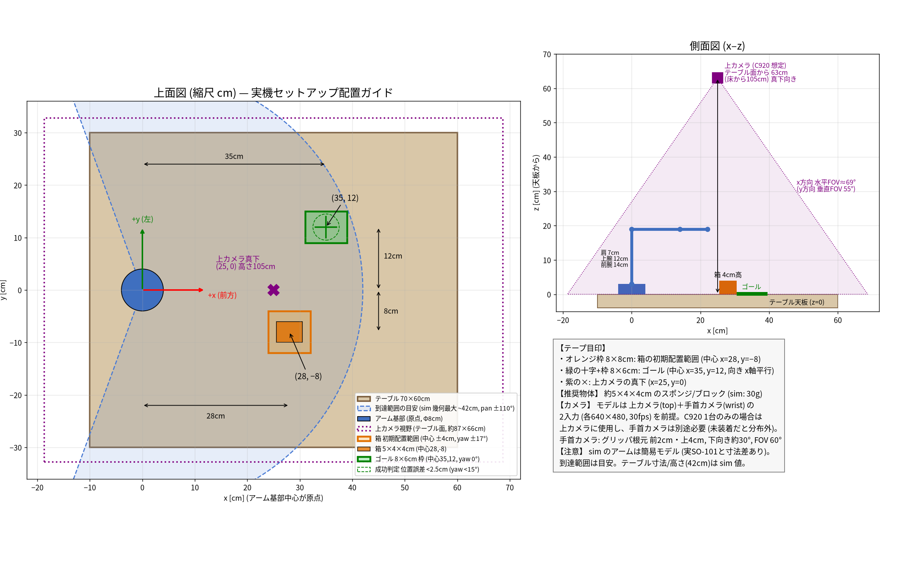

# SO-ARM101 / Feetech STS3215 Dry-Run Procedure

Before wiring and power-on: confirm official specs, set Linux udev rules, resolve Python dependencies, match the current table layout (2026-10-26), and list purchased gear. Limit checks to software connectivity; do not drive motors yet.

## Official specs and reference docs

- [Assemble SO-101](https://huggingface.co/docs/lerobot/en/assemble_so101) (assembly)
- [SO-101](https://huggingface.co/docs/lerobot/en/so101) (motor initial setup with `lerobot-setup-motors` and calibration)
- [SO-100](https://huggingface.co/docs/lerobot/en/so100) (shared software configuration)

Servo motor IDs (1–6) must match the joint-name mapping in this repository’s [`configs/contract.yaml`](../configs/contract.yaml) under `robot.joint_names`.

- Assignment order: `shoulder_pan`, `shoulder_lift`, `elbow_flex`, `wrist_flex`, `wrist_roll`, `gripper`
- LeRobot robot type name: `so101_follower` (use `so101_leader` when using the leader arm)

## Install host Python dependencies

```bash
cd /path/to/lerobot-so101-pick-and-place
python -m venv .venv
source .venv/bin/activate
pip install -U pip
pip install -e "port_pick_align/[training,feetech,dev]"
```

Module import test with no hardware attached:

```bash
python -c "import lerobot; print('lerobot OK', lerobot.__version__)"
# Confirm Feetech motor-bus dependency resolution
python -c "from lerobot.motors.feetech import FeetechMotorsBus; print('feetech OK')"
```

If import raises `ImportError`, re-run `pip install -e "port_pick_align/[feetech]"` and check that C++ extensions and serial libraries installed correctly.

## Identify the serial port

### Linux

```bash
ls -l /dev/ttyACM* /dev/ttyUSB* 2>/dev/null
# Adapter attributes (vendor / product / serial)
udevadm info -a -n /dev/ttyACM0 | head -n 40
```

### macOS

macOS cannot create static udev symlinks, so confirm the device node assigned at connect time.

```bash
ls /dev/tty.usbmodem* /dev/tty.usbserial* 2>/dev/null
```

Pass the detected path (e.g. `/dev/tty.usbmodem585A0076841`) directly to LeRobot arguments.

## Apply udev rules (Linux)

Template: [`deploy/udev/99-feetech-so101.rules`](../deploy/udev/99-feetech-so101.rules)

1. Run `udevadm info` and obtain `idVendor`, `idProduct`, and `serial` for the USB serial adapter in use.
2. Update `REPLACE_*_SERIAL` and SYMLINK names in the template to match the hardware serial numbers.
3. Install the rules file and reload.

```bash
sudo cp deploy/udev/99-feetech-so101.rules /etc/udev/rules.d/
# Reload rules (permissions: MODE=0660 / GROUP=dialout)
sudo udevadm control --reload-rules && sudo udevadm trigger
# dialout group is required (if not a member, add and log out → log in once)
sudo usermod -aG dialout $USER
# After re-login, confirm fixed symlinks exist
ls -l /dev/ttyUSB_so101_*
```

## Initial setup commands when hardware is connected (reference)

Motor ID assignment (replace each port name with the device node on your machine):

```bash
lerobot-setup-motors \
  --robot.type=so101_follower \
  --robot.port=/dev/ttyUSB_so101_follower

lerobot-setup-motors \
  --teleop.type=so101_leader \
  --teleop.port=/dev/ttyUSB_so101_leader
```

Calibration (after the real arm is assembled and 12V power is connected):

```bash
# Follow the official calibrate / control_robot procedure
# Example: python -m lerobot.scripts.control_robot calibrate ...
```

Power notes: Follower Feetech STS3215 (C018) drive voltage is 12V. USB bus power alone will not drive it; connect the kit’s 12V adapter. Leader STS3215 (7.4V rating) is driven at 5V; connect the included 5V adapter (30W). See “[Purchased equipment](#purchased-equipment)” for part names. To avoid bandwidth contention between camera video and serial traffic, separate USB host controllers or use a standards-compliant USB hub.

## Purchased equipment

Place the real hardware on the kitchen table. Layout numbers follow “[Current table layout (2026-10-26)](#current-table-layout-2026-10-26)”.

| Item | Qty | Use / notes |
| --- | --- | --- |
| WowRobo “SO-ARM101 DIY Kit & Assembled Version” Package 3 (Assembled SO-101 Arm, Black) | 1 | Leader 1, Follower 1, camera 1. Vendor-assembled and calibrated |
| Follower Feetech STS3215 12V (C018) | 6 | Follower joint servos. Included in kit |
| Follower bus servo driver (Waveshare / Feetech, DC jack 5.5×2.1 mm) | 1 | Follower servo bus. Included in kit |
| 12V DC power adapter (with UK 3-pin cord) | 1 | Follower drive power. Included in kit |
| Leader Feetech STS3215 7.4V (5V drive) | 6 | Leader joint servos. Included in kit |
| Leader bus servo driver board | 1 | Leader servo bus. Included in kit |
| 5V power adapter (30W, with UK 3-pin cord) | 1 | Leader drive power. Included in kit |
| USB-C cable (white) | 2 | Connect each driver board to the Mac. Included in kit |
| Wrist camera module (with housing, screws included) | 1 | Wrist camera. Mount on the gripper. Included in kit |
| DELIXI C-clamps | 4 | Clamp arm bases to the table. Included in kit |
| 3D-printed parts (orange / black) and small parts | 1 set | Kit print parts and accessories |
| Feetech small box | 1 | Spare STS3215 servo. Confirm voltage on the box label. Included in kit |
| VIJIM LS08 (C-clamp flexible camera arm) | 1 | Clamp the top camera to the table **right edge**, 16 cm from the front, aimed so the paper, sponge, and follower are in frame. Mount screw is 1/4 inch. The older nadir mount at (25, 0) cm is superseded |
| Logitech C920 | 1 | Top camera (USB) |

### Still needed

- Extension cord or power strip. Singapore Safety Mark, UK plug, 3+ outlets. Use for the 12V adapter, 5V adapter, and spare on the kitchen table.

## Current table layout (2026-10-26)

Equipment is listed under “[Purchased equipment](#purchased-equipment)”. This section is the real-robot source of truth for bring-up and live eval (Issue #90, measured 2026-10-26 ~00:36 SGT). It supersedes the 2026-10-25 ~23:28 measurements, the 2026-10-22 figures, and the simplified MuJoCo scene below.

Procedure and the live-eval checklist: [real_robot_bringup.md](real_robot_bringup.en.md#current-table-layout-2026-10-26).

Table: **140 cm** wide × **70 cm** deep.

| Item | Placement | Notes |
| --- | --- | --- |
| Leader base | 27 cm from left / 101 cm from right | 5V. The two distances are opposite sides of the base |
| Follower base | ~68 cm from left / 61 cm from right | 12V. Left distance is approximate |
| Top camera (C920) | Table **right edge**, **16 cm from front** | Aimed so paper, sponge, and follower are in frame. Height was not remeasured |
| Paper (goal) | 69 cm from right, 27 cm from front | Portrait 20 cm wide × 30 cm deep |
| Sponge | 54 cm from right, 44 cm from front | Portrait 6 cm wide × 11 cm deep |
| Wrist camera | On the follower gripper | OpenCV index **0** |
| Top camera index | OpenCV index **1** | 2026-10-25 cable swap, still current |


Printable PDF: [so101_layout_guide.pdf](images/so101_layout_guide.pdf). Regenerate with `python scripts/draw_layout_guide.py`. Output goes to `docs/images/`.

Constants: [`port_pick_align/src/port_pick_align/simulation/table_layout.py`](../port_pick_align/src/port_pick_align/simulation/table_layout.py).

### Sim-frame map

The sim frame matches the existing arm-base convention: origin at the follower, **+x forward** (from the front edge toward the back), **+y left**, +z up.

The 2026-10-26 note does not give a single center for each base, and it does not remeasure how far the bases sit back from the front edge. This map uses two stated conventions:

- A base’s reference point is the **midpoint of the span implied by its two edge distances**. Leader span is 27 cm to 39 cm from the left (midpoint 33 cm). Follower span is 68 cm to 79 cm from the left (midpoint 73.5 cm). Those spans are implied, not a separate width measurement.
- The follower origin is that midpoint **on the front edge** (`v = 0`). A later front inset would shift every `x` by the same constant and would not change `y`.

Paper, sponge, and the top camera use the measured point. The note gives that point and the portrait size; it does not say the point is a corner. The figure centers each footprint on the measured point so the size is visible.

| Item | From left `u` (cm) | From front `v` (cm) | Sim `(x, y)` cm | Sim `(x, y)` m |
| --- | ---: | ---: | --- | --- |
| Leader midpoint | 33 | 0 | (0, 40.5) | (0, 0.405) |
| Follower origin | 73.5 | 0 | (0, 0) | (0, 0) |
| Paper point | 71 | 27 | (27, 2.5) | (0.27, 0.025) |
| Sponge point | 86 | 44 | (44, −12.5) | (0.44, −0.125) |
| Top camera | 140 | 16 | (16, −66.5) | (0.16, −0.665) |

`u = 140 − (cm from right)`. `x = v` under the front-edge convention. `y = 73.5 − u`.

### Cameras

ACT inputs are both the top camera (`/camera/top/image_raw`) and the wrist camera (`/camera/wrist/image_raw`). Resolution is 640×480 each at 30 fps ([`configs/contract.yaml`](../configs/contract.yaml)). Mount the C920 with the VIJIM LS08 on the right edge, 16 cm from the front, aimed so the paper, sponge, and follower are in frame. Mount the kit wrist-camera module on the follower gripper. OpenCV indices: wrist `0`, top `1`. Missing wrist imagery is out of distribution for training.

### Work-area prep checklist

- [ ] Table is 140 cm wide × 70 cm deep
- [ ] Leader base is 27 cm from the left / 101 cm from the right (5V)
- [ ] Follower base is ~68 cm from the left / 61 cm from the right (12V)
- [ ] Paper is 69 cm from the right and 27 cm from the front (portrait 20×30 cm)
- [ ] Sponge is 54 cm from the right and 44 cm from the front (portrait 6×11 cm)
- [ ] C920 is on the right edge, 16 cm from the front, with paper, sponge, and follower in frame
- [ ] Wrist camera is on the follower gripper; OpenCV wrist `0`, top `1` confirmed
- [ ] Superseded marks (below) are not used for new setup

## Superseded layouts

Do not use these for new sim alignment, bring-up, or live eval.

### 2026-10-25 ~23:28

Table was listed as 140×69 cm. C920 at 28 cm from the right. Sponge 70 cm from the right / 45 cm from the front. Paper 82 cm from the right / 26 cm from the front. Follower 62 cm from the right.

### 2026-10-22 recording layout

Used for the main teleop dataset only. Table width about 134 cm. Leader left edge 28 cm. Paper 56 cm from the left / 13 cm from the front. Follower left edge 78 cm. Sponge 81 cm from the left / 29 cm from the front. Top-camera pole 111 cm from the left. Details: [real_robot_bringup.md](real_robot_bringup.en.md#superseded-layouts).

### Simplified MuJoCo scene (pre-2026-10-26 figure)

The checked-in scene still uses these geoms so existing sim eval keeps running. They are **not** the real table. A later sim align should move them onto the sim-frame map above.



PDF: [so101_layout_guide_superseded_pre_20261026.pdf](images/so101_layout_guide_superseded_pre_20261026.pdf).

| Item | Value | Source |
| --- | --- | --- |
| Tabletop | z = 0.42 m (floor at z = 0); top view 70×60 cm | `TABLE_Z` in `env.py`. XML table geom center `(0.25, 0, 0.40)`, half-size `0.35 0.30 0.02` |
| Box | 5×4×4 cm, 30 g | XML `box_geom` half-size `0.025 0.02 0.02`, `mass="0.03"` |
| Box initial center | (28, −8) cm. xy ±4 cm each, yaw ±0.3 rad (≈ ±17°) uniform | `env.py` reset. Base `(0.28, -0.08)` plus `uniform(-0.04, 0.04)`; yaw `uniform(-0.3, 0.3)` |
| Goal `target_frame` | Center (35, +12) cm, pad 8×6 cm, yaw 0 | XML `target_frame` pos `0.35 0.12 0.42`, `target_pad` half-size `0.04 0.03` (no rotation) |
| Alignment success | Planar position error ≤ 25 mm and yaw error ≤ 15° | `DEFAULT_ALIGN_POS_MM = 25`, `DEFAULT_ALIGN_YAW_DEG = 15` in `eval_alignment.py` (both `<=`) |
| Top camera | Planar (25, 0) cm, 63 cm above tabletop (world z = 1.05 m), straight down, vertical FOV 55°. Field of view on tabletop ≈ 87×66 cm (estimate) | XML `camera name="top"` pos `0.25 0 1.05`, `xyaxes="1 0 0 0 1 0"`, `fovy="55"` |
| Wrist camera | 2 cm forward and 4 cm up from gripper link origin, ~30° downward, vertical FOV 60° | XML `camera name="wrist"` pos `0.02 0 0.04`, `xyaxes="0 -1 0 0.5 0 0.866"`, `fovy="60"` |
| Reach | ≈ 42 cm (`shoulder_pan` ±110°. Geometric max of the simplified model) | Upper arm 12 cm + forearm 14 cm + wrist 8 cm + gripper 3 cm + end-effector site 5 cm. pan range ±1.9199 rad |

The top-camera FOV ≈ 87×66 cm is estimated from height 63 cm above the tabletop, vertical FOV 55°, and contract image aspect 640×480. x (horizontal FOV ≈ 69°) ≈ 87 cm; y (vertical FOV 55°) ≈ 66 cm. That estimate belongs to the superseded nadir camera, not the 2026-10-26 right-edge mount. The real C920 height was not remeasured on 2026-10-26.

Sources for this superseded scene only:

- [`port_pick_align/src/port_pick_align/simulation/assets/so101_tabletop.xml`](../port_pick_align/src/port_pick_align/simulation/assets/so101_tabletop.xml)
- [`port_pick_align/src/port_pick_align/simulation/env.py`](../port_pick_align/src/port_pick_align/simulation/env.py)
- [`port_pick_align/src/port_pick_align/evaluation/eval_alignment.py`](../port_pick_align/src/port_pick_align/evaluation/eval_alignment.py)

## Pre-work checklist

- [ ] Reviewed official SO-101 and Feetech setup procedures
- [ ] Successfully installed `port_pick_align/[training,feetech]` dependencies
- [ ] Passed import tests for `lerobot` and Feetech motors modules
- [ ] On Linux, configured udev rules from hardware-specific serial numbers
- [ ] On macOS, know how to identify `/dev/tty.usbmodem*` devices
- [ ] Understand motor setup and calibration commands to run after hardware arrives

