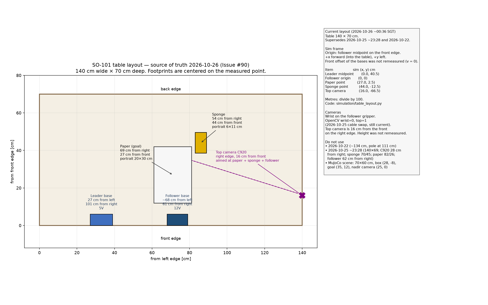

# SO-ARM101 / Feetech STS3215 ドライラン手順書

本手順書は、実機アームの接続前に必要な公式仕様の確認、Linux 環境での udev ルール設定、および Python 依存関係の解決を行うための事前準備手順を定める。あわせて、簡易シミュレーションと同じ座標系で作業エリアを組む配置を定め、購入済み機材を一覧する。配線および電源投入前の段階では物理的な駆動を行わず、ソフトウェア的な接続確認にとどめる。

## 公式仕様と参照ドキュメント

- [Assemble SO-101](https://huggingface.co/docs/lerobot/en/assemble_so101)（組立手順）
- [SO-101](https://huggingface.co/docs/lerobot/en/so101)（モータ初期設定 `lerobot-setup-motors` およびキャリブレーション手順）
- [SO-100](https://huggingface.co/docs/lerobot/en/so100)（ソフトウェア構成の共通仕様）

サーボモータの ID（1〜6）と関節名の対応は、本リポジトリの [`configs/contract.yaml`](../configs/contract.yaml) における `robot.joint_names` の定義と一致させる。

- 割り当て順序: `shoulder_pan`, `shoulder_lift`, `elbow_flex`, `wrist_flex`, `wrist_roll`, `gripper`
- LeRobot におけるロボット識別名: `so101_follower`（リーダー側を使用する場合は `so101_leader`）

## ホスト Python 依存パッケージの導入

```bash
cd /path/to/lerobot-so101-pick-and-place
python -m venv .venv
source .venv/bin/activate
pip install -U pip
pip install -e "port_pick_align/[training,feetech,dev]"
```

機材非接続状態におけるモジュール読み込みテスト:

```bash
python -c "import lerobot; print('lerobot OK', lerobot.__version__)"
# Feetech モータバス実装の依存関係解決を確認
python -c "from lerobot.motors.feetech import FeetechMotorsBus; print('feetech OK')"
```

読み込み時に `ImportError` が発生した場合は、`pip install -e "port_pick_align/[feetech]"` を再実行して C++ 拡張モジュールやシリアル通信ライブラリの導入状況を確認する。

## シリアル通信ポートの識別

### Linux 環境

```bash
ls -l /dev/ttyACM* /dev/ttyUSB* 2>/dev/null
# アダプタの属性（vendor / product / serial）の確認
udevadm info -a -n /dev/ttyACM0 | head -n 40
```

### macOS 環境

macOS では udev による静的シンボリックリンク生成が行えないため、接続時に割り当てられたデバイスファイル名を直接確認する。

```bash
ls /dev/tty.usbmodem* /dev/tty.usbserial* 2>/dev/null
```

LeRobot の実行引数には、検出されたパス（例: `/dev/tty.usbmodem585A0076841`）を直接指定する。

## udev ルールの適用（Linux 環境）

設定テンプレート: [`deploy/udev/99-feetech-so101.rules`](../deploy/udev/99-feetech-so101.rules)

1. `udevadm info` を実行し、使用する USB シリアル変換器の `idVendor`, `idProduct`, `serial` を取得する。
2. テンプレート内の `REPLACE_*_SERIAL` および SYMLINK 名を実際の機材シリアル番号に合わせて更新する。
3. ルールファイルをシステムへ配置し、反映する。

```bash
sudo cp deploy/udev/99-feetech-so101.rules /etc/udev/rules.d/
# ルール反映（権限は MODE=0660 / GROUP=dialout）
sudo udevadm control --reload-rules && sudo udevadm trigger
# dialout グループ必須（未所属なら追加後、一度ログアウト→再ログイン）
sudo usermod -aG dialout $USER
# 再ログイン後に固定シンボリックリンクの生成を確認
ls -l /dev/ttyUSB_so101_*
```

## 実機接続時の初期設定コマンド（参考仕様）

モータ ID の割り当て（各ポート名は使用環境のデバイスファイル名に置換する）:

```bash
lerobot-setup-motors \
  --robot.type=so101_follower \
  --robot.port=/dev/ttyUSB_so101_follower

lerobot-setup-motors \
  --teleop.type=so101_leader \
  --teleop.port=/dev/ttyUSB_so101_leader
```

キャリブレーション処理（実機の組み立ておよび 12V 電源投入後に実施）:

```bash
# 公式ドキュメントの calibrate / control_robot 手順に準拠して実行する
# 例: python -m lerobot.scripts.control_robot calibrate ...
```

電源仕様上の注意: Follower 側 Feetech STS3215（C018）の駆動電圧は 12V である。USB バスパワーのみでは駆動しないため、キット付属の 12V アダプタを接続する。Leader 側 STS3215（7.4V 仕様）は 5V で駆動し、付属の 5V アダプタ（30W）を接続する。品目は「[購入済み機材](#購入済み機材)」を参照する。また、カメラ画像転送とシリアル通信の帯域競合を防止するため、USB ホストコントローラの分離または規格に適合した USB ハブを経由して接続する。

## 購入済み機材

実機はキッチンのテーブルに置く。配置の数値は「[作業エリアの配置](#作業エリアの配置シミュレーション準拠)」に従う。

| 品目 | 数量 | 用途・備考 |
| --- | --- | --- |
| WowRobo「SO-ARM101 DIY Kit & Assembled Version」Package 3（Assembled SO-101 Arm、Black） | 1 | Leader 1、Follower 1、カメラ 1。ベンダーが組立・校正済み |
| Follower 用 Feetech STS3215 12V（C018） | 6 | Follower の関節サーボ。キット同梱 |
| Follower 用バスサーボドライバ（Waveshare / Feetech、DC ジャック 5.5×2.1 mm） | 1 | Follower のサーボバス。キット同梱 |
| 12V DC 電源アダプタ（UK 3 ピンコード付き） | 1 | Follower の駆動電源。キット同梱 |
| Leader 用 Feetech STS3215 7.4V（5V 駆動） | 6 | Leader の関節サーボ。キット同梱 |
| Leader 用バスサーボドライバ基板 | 1 | Leader のサーボバス。キット同梱 |
| 5V 電源アダプタ（30W、UK 3 ピンコード付き） | 1 | Leader の駆動電源。キット同梱 |
| USB-C ケーブル（白） | 2 | 各ドライバ基板と Mac を接続。キット同梱 |
| 手首カメラモジュール（ハウジング付き、ネジ同梱） | 1 | 手首カメラ。グリッパへ固定する。キット同梱 |
| DELIXI C クランプ | 4 | アーム基部をテーブルへ固定する。キット同梱 |
| 3D プリント部品（橙・黒）および小物 | 一式 | キット付属の造形部品とアクセサリ |
| Feetech 小箱 | 1 | 予備サーボ STS3215。電圧は箱のラベルで確認。キット同梱 |
| VIJIM LS08（C クランプ式フレキシブルカメラアーム） | 1 | 天板の縁をクランプし、上カメラを基部から平面約 (25, 0) cm、天板から 63 cm の位置で真下向きに保持する。取付ネジは 1/4 インチ |
| Logitech C920 | 1 | 上カメラ（USB） |

### まだ購入が必要なもの

- 延長コードまたは電源タップ。シンガポールの Safety Mark 付き、UK プラグ、差込口 3 口以上。12V アダプタ、5V アダプタ、予備をキッチンのテーブルで使う。

## 作業エリアの配置（シミュレーション準拠）

使用する機材は「[購入済み機材](#購入済み機材)」に示す。原点はアーム基部の中心、+x は前方、+y は左、+z は上である。下表の平面位置は基部中心からの距離である。数値は簡易 MuJoCo シーンから読んだものであり、実機 SO-101 のリンク長とは寸法差がある。到達範囲は目安である。

出典:

- [`port_pick_align/src/port_pick_align/simulation/assets/so101_tabletop.xml`](../port_pick_align/src/port_pick_align/simulation/assets/so101_tabletop.xml)
- [`port_pick_align/src/port_pick_align/simulation/env.py`](../port_pick_align/src/port_pick_align/simulation/env.py)
- [`port_pick_align/src/port_pick_align/evaluation/eval_alignment.py`](../port_pick_align/src/port_pick_align/evaluation/eval_alignment.py)



印刷用 PDF: [so101_layout_guide.pdf](images/so101_layout_guide.pdf)。図の再生成は `python scripts/draw_layout_guide.py` であり、出力先は `docs/images/` である。

| 項目 | 値 | 出典 |
| --- | --- | --- |
| テーブル天板 | z = 0.42 m（床を z = 0 とする） | `env.py` の `TABLE_Z`。XML の table geom は中心 z = 0.40 m、半厚 0.02 m |
| 箱 | 5×4×4 cm、30 g | XML `box_geom` の half-size `0.025 0.02 0.02`、`mass="0.03"` |
| 箱の初期中心 | (28, −8) cm。xy を各 ±4 cm、yaw を ±0.3 rad（約 ±17°）で一様乱数 | `env.py` の reset。基準 `(0.28, -0.08)` に `uniform(-0.04, 0.04)`、yaw は `uniform(-0.3, 0.3)` |
| ゴール `target_frame` | 中心 (35, +12) cm、パッド 8×6 cm、yaw 0 | XML `target_frame` pos `0.35 0.12 0.42`、`target_pad` half-size `0.04 0.03`（回転なし） |
| 整列成功 | 平面位置誤差 25 mm 以内、かつヨー誤差 15° 以内 | `eval_alignment.py` の `DEFAULT_ALIGN_POS_MM = 25`、`DEFAULT_ALIGN_YAW_DEG = 15`（いずれも `<=`） |
| 上カメラ | 平面 (25, 0) cm、天板から 63 cm（ワールド z = 1.05 m）、真下向き、垂直 FOV 55°。天板上の視野は約 87×66 cm（推定） | XML `camera name="top"` の pos `0.25 0 1.05`、`xyaxes="1 0 0 0 1 0"`、`fovy="55"` |
| 手首カメラ | グリッパリンク原点から前方 2 cm・上方 4 cm、下向き約 30°、垂直 FOV 60° | XML `camera name="wrist"` の pos `0.02 0 0.04`、`xyaxes="0 -1 0 0.5 0 0.866"`、`fovy="60"` |
| 到達範囲 | 約 42 cm（`shoulder_pan` ±110°。簡易モデルの幾何最大） | 上腕 12 cm + 前腕 14 cm + 手首 8 cm + グリッパ 3 cm + 手先サイト 5 cm。pan range は ±1.9199 rad |

上カメラの視野約 87×66 cm は、天板からの高さ 63 cm、垂直 FOV 55°、契約画像 640×480 のアスペクトから求めた推定である。x 方向（水平 FOV 約 69°）が約 87 cm、y 方向（垂直 FOV 55°）が約 66 cm である。XML が持つのはカメラ位置と `fovy` であり、視野の辺長はそこから計算する。

### テープ目印（提案）

以下は実機セットアップ用の提案である。同じ初期分布とゴールをテーブル上で再現するための目印である。

- オレンジ枠 8×8 cm: 箱の中心が取りうる初期範囲。枠の中心は (28, −8) cm。
- 緑の十字と枠 8×6 cm: ゴール。中心は (35, +12) cm。長辺を x 軸に平行（yaw 0）にする。
- 紫の ×: 上カメラの真下。(25, 0) cm。
- 物体は一辺約 5 cm のスポンジまたはブロックを推奨する。sim の箱は 5×4×4 cm、30 g である。

### カメラ

ACT の入力は上カメラ（`/camera/top/image_raw`）と手首カメラ（`/camera/wrist/image_raw`）の両方である。解像度は各 640×480、30 fps（[`configs/contract.yaml`](../configs/contract.yaml)）。上カメラは Logitech C920 とし、VIJIM LS08 で平面 (25, 0) cm の真上、天板から 63 cm、真下向きに固定する。手首カメラはキット同梱のモジュールをグリッパへ取り付ける。品目は「[購入済み機材](#購入済み機材)」を参照する。手首画像が無い状態は学習時の分布の外である。

### 作業エリア準備チェックリスト

- [ ] アーム基部中心を原点、前方を +x、左を +y としてテーブル上の座標を決めた
- [ ] テーブル天板高さを sim の 0.42 m に合わせ、合わせられない場合は差分を記録した
- [ ] 提案のテープ目印（オレンジ枠、緑の十字と枠、紫の ×）を貼った
- [ ] 約 5×4×4 cm、30 g 程度のスポンジまたはブロックを用意した
- [ ] 上カメラ（C920）を VIJIM LS08 で (25, 0) cm の真上、天板から 63 cm、真下向きに固定した
- [ ] 上カメラ（C920）とキット同梱の手首カメラを接続した

## 事前準備チェックリスト

- [ ] 公式 SO-101 および Feetech のセットアップ手順を確認した
- [ ] `port_pick_align/[training,feetech]` の依存関係インストールが正常に完了した
- [ ] `lerobot` および Feetech motors モジュールのインポート試験に通過した
- [ ] Linux 環境において、機材固有のシリアル番号に基づく udev ルールを設定した
- [ ] macOS 環境において、`/dev/tty.usbmodem*` デバイスの確認手順を把握した
- [ ] 実機到着後に実行するモータ設定およびキャリブレーションのコマンド仕様を把握した

