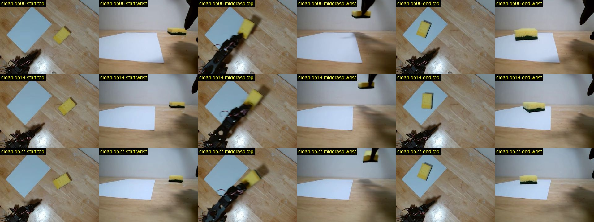

# Real teleop dataset: `so101_pick_sponge_main` (clean28)

Factual record. Computed around 2026-10-23 01:15 SGT (the working Mac, LeRobot 0.6.1 venv). Read-only; the dataset was not modified.

**The dataset itself lives outside git (on the Mac).** Only this document and the contact-sheet image are in the repository.

Related procedure: [real_robot_bringup.md](real_robot_bringup.en.md). Training: [training.md](training.en.md).

## Dataset

| | Path on Mac | Episodes | Frames | `du -sh` |
| --- | --- | ---: | ---: | ---: |
| raw | `$HOME/work/lerobot-hw/datasets/so101_pick_sponge_main_20261020` | 32 (0–31) | 23,610 | 350M |
| clean | `$HOME/work/lerobot-hw/datasets/so101_pick_sponge_main_20261023_clean28` | 28 (0–27) | 20,660 | 309M |

- Task (single, `task_index` 0): `Pick up the yellow sponge and place it on the white paper`
- `repo_id` `yohei1126/so101_pick_sponge_main`, `robot_type` `so_follower`, `codebase_version` v3.0, split train `0:28`
- fps 30. Features: `action` (6, float32), `observation.state` (6, float32), `observation.images.top`, `observation.images.wrist`, timestamp, frame_index, episode_index, index, task_index
- Joint names (action / state): `shoulder_pan`, `shoulder_lift`, `elbow_flex`, `wrist_flex`, `wrist_roll`, `gripper` (`.pos`)
- Cameras: `observation.images.top`, `observation.images.wrist`. Both 640×480, AV1, yuv420p, 30 fps, g=2, crf=30, preset 12, no audio
- Layout: 3 parquet files, 3 mp4 files per camera (`chunk-000/file-000..002`)
- Directory name is `20261020`, but recording ran 2026-10-22 23:30 – 2026-10-23 00:38 SGT (see logs)
- Physical layout for these episodes is the superseded 2026-10-22 table, not the 2026-10-26 source of truth. See [Superseded layouts](real_robot_bringup.en.md#superseded-layouts)

The table above is the 2026-10-23 snapshot. On 2026-10-27 05:04–05:11 SGT, episodes 32–41 (10 episodes, 7,369 frames) were appended to the same `20261020` root. Those 10 demos are the Issue #90 (2026-10-26 layout) set, extracted as episodes 0–9 at `$HOME/work/lerobot-hw/datasets/so101_pick_sponge_layout20261026_20261027`. Later demos default to that extracted root. `scripts/record_real_so101.sh` refuses to record into `20261020`.

## clean ↔ raw mapping (action / state arrays confirmed identical)

- clean 0–7 = raw 0–7
- clean 8–16 = raw 10–18
- clean 17–19 = raw 20–22
- clean 20–27 = raw 24–31

Excluded raw episodes:

| raw | Reason |
| ---: | --- |
| 8 (750 frames), 9 (743 frames) | Action range 0 on all joints (stationary) |
| 19 | `shoulder_lift` mean `|action-state|` 9.73, max 45.2 |
| 23 | `shoulder_lift` mean `|action-state|` 12.07, max 34.4 |

clean-set `shoulder_lift` mean lag is 1.36–2.58 per episode.

## Episode length

- 20 episodes at 750 frames (25.0 s = `episode_time_s` cap)
- 8 episodes at 705–709 frames (23.5–23.63 s; clean 7, 15, 16, 23–27)
- Mean 24.60 s, std 0.64 s (population; sample std 0.65), min 23.50, max 25.00
- Timestamps are contiguous at 1/30 s. Per episode, `frame_index` is 0..n-1
- Motion: first motion (any joint > 1 from initial) at 1.2–6.1 s. Arm settle (all joints within 1 of final) at 7.9–13.6 s, mean 9.6 s. Roughly the last 10–17 s of each episode is stationary

## Joint ranges (clean overall, min / max)

| joint | action min | action max | state min | state max | mean abs(action-state) |
| --- | ---: | ---: | ---: | ---: | ---: |
| shoulder_pan | -52.7 | 16.7 | -52.5 | 16.4 | 0.63 |
| shoulder_lift | -69.1 | 84.0 | -68.0 | 81.5 | 1.66 |
| elbow_flex | -96.3 | 96.8 | -94.7 | 96.9 | 1.67 |
| wrist_flex | -0.6 | 101.0 | 0.7 | 100.3 | 0.89 |
| wrist_roll | -25.7 | 8.7 | -25.4 | 8.5 | 0.24 |
| gripper | 0.0 | 77.4 | 0.8 | 76.8 | 1.08 |

## Gripper and grasp counts

Per-episode gripper: idle ≈ 14–48 → open ≈ 48–77 → close ≈ 0–1 (grasp) → reopen ≈ 14–49 (release) then hold.

Because idle / post-release values sit near mid-range, a fixed midpoint threshold is unreliable. Counted with per-episode hysteresis on action: grasp = gripper descends below (episode min + 5); release = later rises above (episode min + 10).

- 27/28 episodes: 1 grasp · 1 release. Grasp 4.4–8.4 s, release 5.5–10.4 s
- clean 25 (raw 29): 2 grasp · 2 release (G 3.8 s, R 4.5 s, G 5.7 s, R 7.7 s) = re-grasp
- Per-episode gripper action max 48.2–77.4. min is 0.0–0.6 (only clean 10 / raw 12 has min 10.3; does not close below ~10)

Per-episode table (on Mac): `per_episode_events.csv`.

## Outliers / notes

- clean 25 (raw 29): re-grasp (2 closes)
- clean 15, 16 (raw 17, 18): wider pose range than others (`elbow_flex` action min -96.3 / -82.1, others mostly ≥ -44; `shoulder_lift` max 84.0 / 80.7; `wrist_flex` max ≈ 101). Highest `shoulder_lift` lag (2.58, 2.44; z > 2.5). clean 15 has the latest settle (13.6 s)
- clean 27 (raw 31): `elbow_flex` mean lag 5.00 (set mean 1.68, z > 2.5)
- clean 0: latest start (6.1 s), latest grasp (8.4 s)
- clean 10 (raw 12): gripper min 10.3
- `wrist_roll` action drifts from ≈ -8..+9 on clean 0–9 to ≈ -26..-13 on clean 23–27

## Recording sessions

Logs: `$HOME/work/lerobot-hw/outputs/record_main_*.log` (times in SGT). All used root `.../so101_pick_sponge_main_20261020`, `episode_time_s` 25, `reset_time_s` 10, fps 30, `push_to_hub` False.

| log | resume | num_episodes arg | Episodes recorded | End |
| --- | --- | ---: | --- | --- |
| 20261022_231932 | False | 50 | started 0–12 (13) | KeyboardInterrupt mid ep 12 (23:28) |
| 20261022_233039 | False | 50 | 0–9 (10) | Esc mid ep 9, stop 23:37:54 |
| 20261022_233916 | True | 10 | 10–19 (10) | clean stop 23:46:30 |
| 20261023_002944 | True | 12 | 20–31 (12) | clean stop 00:38:25 |

The second session restarted from episode 0 with `resume=False`, so the raw 32 episodes come from sessions 2–4 (10 + 10 + 12). Logs suggest raw 9 is 743 frames because Esc ended it early. Session 1 data is not in the dataset.

## Sample frames (contact sheet)

Rows = clean ep 0, 14, 27. Columns = start top/wrist, midgrasp top/wrist (midpoint of grasp and release), end top/wrist. At start the sponge is off the paper; at midgrasp the gripper holds it; at end it is on the paper.

Individual PNGs (on Mac): `$HOME/work/lerobot-hw/outputs/dataset_summary_20261023/ep{00,14,27}_{start,midgrasp,end}_{top,wrist}.png`.

## Overnight ACT training (started 2026-10-23 00:52 SGT, completed)

Completed 25,000 steps. Best checkpoint at step 21,000 (`val_l1=4.454`).

| Item | Value |
| --- | --- |
| Entry | `port_pick_align.training.train_act` |
| arch | `full` |
| device | MPS |
| batch | 8 |
| lr | 1e-4 |
| steps | 25,000 (completed) |
| val_ratio | 0.1 |
| selection | `val_l1` (best: step 21,000, `val_l1=4.454`) |
| Speed | ≈ 0.75 s / step |
| End time | 2026-10-23 06:12 SGT |
| Output | `$HOME/work/lerobot-hw/outputs/act_so101_main_clean28_20261023` |
