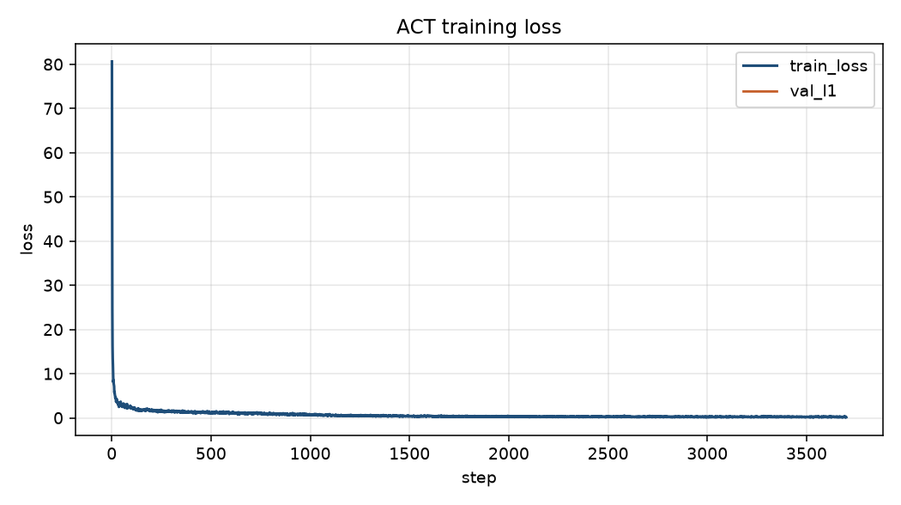
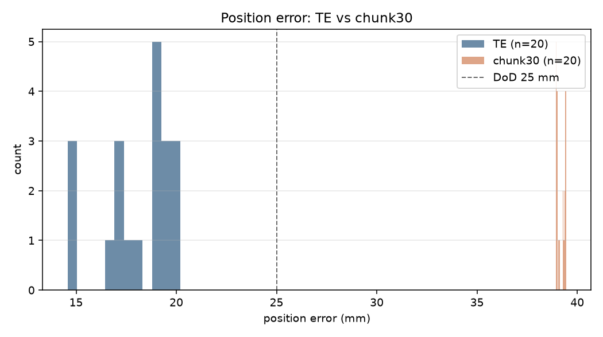
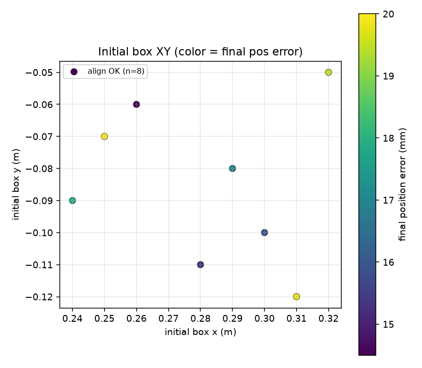

<!-- markdownlint-disable MD013 MD024 MD060 -->

# Physical AI Applied 1 Final Assignment: Explanatory Report

**OmniCampus account name:** `yohei1126`

> Note: Do not include personally identifying information such as real name, affiliation, or email address.  
> This manuscript is for the submission PDF (DoD ⑤). Remaining TODOs are real-robot evidence links, the results video, and the final PDF only (Appendix B). Produce the PDF with `./scripts/build_report_pdf.sh yohei1126`.

## 0. Sources of truth (JSON, units, figures)

- Canonical quantitative values are the JSON files pinned under `docs/results/` ([`docs/results/README.md`](../docs/results/README.en.md), [`post50_official_summary.json`](../docs/results/post50_official_summary.json)). Display rounding follows the summary file; transcription evidence is each cell JSON’s `summary` and episode arrays.
- Units follow [`docs/units.md`](../docs/units.en.md) (and `port_pick_align/units.py`).
- Figures are under [`docs/figures/`](../docs/figures/) ([`manifest.json`](../docs/figures/manifest.json)).
- Other primary sources: [Issue #23](https://github.com/yohei1126/lerobot-so101-pick-and-place/issues/23) (DoD), [PR #34](https://github.com/yohei1126/lerobot-so101-pick-and-place/pull/34#issuecomment-6233795103) (post50 pipeline history), [PR #52](https://github.com/yohei1126/lerobot-so101-pick-and-place/pull/52) / [Issue #51](https://github.com/yohei1126/lerobot-so101-pick-and-place/issues/51), [`docs/plan_b.md`](../docs/plan_b.en.md), [`docs/hardware.md`](../docs/hardware.en.md).

---

## 1. Problem setting and social context (creativity) / Problem and goals (DoD)

### 1.1 Problem

The assignment is tabletop grasp-and-align: place a rectangular box so planar position error ≤ 25 mm and yaw error ≤ 15 deg, with a reproducible RobOps loop (collect → train → eval). The mock stands in for tight-tolerance alignment work where skilled labor is scarce and rework after failure is costly (for example shipbuilding, maritime, and port sites).

### 1.2 Task definition

| Item | Content |
| --- | --- |
| Object | Small rectangular box (tabletop mock; stands in for on-site containers / parts pallets) |
| Goal | Place so planar position and yaw match a tabletop target frame (pad) |
| Success criteria (eval API) | Planar position error ≤ 25 mm, yaw error ≤ 15 deg ([`docs/evaluation.md`](../docs/evaluation.en.md), [`docs/hardware.md`](../docs/hardware.en.md)) |
| Observation | Top / Wrist dual cameras (640×480, 30 fps) and 6-DoF joints |
| Control | Joint-position commands via ACT (chunk_size=30). Temporal Ensembling (TE) is also evaluated for comparison |

### 1.3 Phase 1.5 completion criteria (DoD)

Source: [Issue #23](https://github.com/yohei1126/lerobot-so101-pick-and-place/issues/23).

| # | Item | Status | Evidence |
| --- | --- | --- | --- |
| ① | Automated demonstration collection (50–100 episode LeRobotDataset) | Achieved | post50 pipeline (`checkpoints/sim_act_post50`) |
| ② | Full training on MPS | Achieved | Same. Learning curves in Figure 2 |
| ③ | Temporal Ensembling implementation | Achieved | TE eval cells and code |
| ④ | Quantitative benchmark (align ≥ 85%, mean position error < 25 mm) | **Achieved in TE mode** | [`eval_sim_act_post50_best_model_te_te.json`](../docs/results/eval_sim_act_post50_best_model_te_te.json) |
| ⑤ | Submission PDF | **Incomplete** | TODO: owner builds final PDF |

**DoD ④ achievement mode:**  
When `best_model_te` is evaluated with Temporal Ensembling (`n_action_steps=1`), align success rate is 1.000 and mean position error is 18.081 mm (median 18.955 mm), meeting DoD. Canonical: [`docs/results/eval_sim_act_post50_best_model_te_te.json`](../docs/results/eval_sim_act_post50_best_model_te_te.json) (index: [`post50_official_summary.json`](../docs/results/post50_official_summary.json)).  
Early benchmark docs treated the chunk30 side as the achievement criterion; this manuscript states **TE as the primary achievement** based on measured runs that meet DoD. The chunk30 comparison cell does not meet DoD (Chapter 5).

The reference grasp-success threshold (≥ 90%) is in [`docs/results/README.md`](../docs/results/README.en.md); the TE cell above has grasp rate 1.000.

### 1.4 Differentiation from the official sample

This repo puts (1) contract SSOT via `configs/contract.yaml`, (2) rosbag2→LeRobot conversion and quality validators, (3) GitHub Actions CI, (4) ROS 2 inference mock and Rerun, and (5) MuJoCo closed-loop evaluation in one tree, with port-style alignment as the tabletop task and RobOps from quality checks through retraining.

---

## 2. Stack: MuJoCo, ACT, contract SSOT (technical skill) / Environment

### 2.1 Simulation environment

| Item | Content |
| --- | --- |
| Physics engine | MuJoCo (`PickAlignSimEnv`, asset `so101_tabletop.xml`) |
| Arm | SO-101-class 6 DoF (`lerobot_type: so101_follower`) |
| Learning stack | LeRobot + ACT (ResNet18, chunk_size=30) |
| Primary training device | Mac Apple Silicon (MPS) |
| Contract SSOT | [`configs/contract.yaml`](../configs/contract.yaml) (images 640×480, joint names, chunk_size) |

### 2.2 Software stack

| Execution layer | Role |
| --- | --- |
| Docker (ROS 2 Humble) | Inference mock, rosbag, Rerun, validator integration tests |
| Host venv (`port_pick_align`) | Demo collection, ACT training, convert/validate, MuJoCo eval |
| Unattended pipeline | `scripts/run_pipeline.sh` (collect → train → all ckpt × chunk30/TE eval) |

```text
[MuJoCo scripted expert] ──collect──▶ LeRobotDataset
        │
        ▼
   ACT train (MPS) ──▶ best_model.pt / best_model_te.pt
        │
        ├─▶ chunk30 eval (n_action_steps=30)
        └─▶ TE eval (temporal ensembling, n_action_steps=1)
                 └──▶ docs/results/*.json (pinned)
```

### 2.3 Units (sim / contract / real robot)

Source: [`docs/units.md`](../docs/units.en.md).

| System | Arm 5 axes | Gripper | Box yaw / eval yaw |
| --- | --- | --- | --- |
| MuJoCo sim / `contract.yaml` | **radians** | **radians** (6th dim) | sim `box_yaw` is radians. Yaw error in `metrics.json` is **degrees** |
| Real LeRobot SO-101 (typical) | **degrees** | **0–100** (open percent) | Align to degrees for real-robot eval |

Contract gripper range is `[-0.1745, 1.7453]` rad. Linear maps to 0–100 are `gripper_rad_to_percent` / `gripper_percent_to_rad` (`port_pick_align/units.py`). Before training on real data, confirm units in real-robot logs and convert to contract radians if needed.

### 2.4 Real-robot hardware (readiness)

Design target is SO-ARM101 (Feetech STS3215) + Top/Wrist cameras. Layout and equipment list: [`docs/hardware.md`](../docs/hardware.en.md).

| Item | Status | Source |
| --- | --- | --- |
| SO-101 Leader / Follower | Calibrated; leader→follower teleop works (owner report 2026-10-17) | TODO: owner attaches evidence links (video / logs) |
| Control rate | ~60 Hz (same) | TODO: same |
| Cameras | Setup in progress (C920 top camera, wrist camera) | [`docs/hardware.md`](../docs/hardware.en.md) |
| Next steps | `lerobot-record` → train → `lerobot-rollout` | Not started |

---

## 3. Data pipeline and quality management (RobOps / technical skill) / Method (data)

### 3.1 Collection

1. Roll out `ScriptedPickAlignPolicy` in MuJoCo and save images + joint targets as a LeRobotDataset (`scripts/collect_sim_dataset.py`).
2. Randomize initial box planar pose and yaw; record only successful alignment episodes ([`docs/dataset.md`](../docs/dataset.en.md)).
3. `validate_episode` checks sync drift, frame intervals, joint limits, and stasis.
4. Demonstration trajectories were iteratively improved (yaw alignment during carry, closed approach+place near the pad, open hold-release, etc. Issue #39/#41/#45 series).

The post50 run is collect/train/eval via `scripts/run_pipeline.sh` (checkpoint directory `sim_act_post50`).

### 3.2 Quality gates

| Check | Threshold (contract) |
| --- | --- |
| Time sync | Flag drift beyond 33 ms |
| Frame drop | Flag gaps beyond 50 ms |
| Schema | Match `contract.yaml` |
| Official collect flags | 50–100 epi, 640×480, 260 step, etc. ([`docs/dataset.md`](../docs/dataset.en.md)) |

---

## 4. Model selection and training (technical skill) / Method (ACT · TE)

### 4.1 ACT settings

| Item | Setting |
| --- | --- |
| Model | ACT (Action Chunking with Transformers) |
| Vision backbone | ResNet18 |
| chunk_size | 30 |
| Action dim | 6 (joints + gripper) |
| Train preset | `--preset sim` (select `best_model.pt` by closed-loop align; save TE-best separately as `best_model_te.pt`) |
| Device | MPS (Mac M4 class) |
| Early stop | After `--min-steps` (default 3000), lexicographic progress on `(align rate, −mean position error)` (PR #50) |

### 4.2 Temporal Ensembling

In closed loop, emit the latest chunk every step and smooth commands with an exponential weighted average of past predictions (default coefficient 0.01; eval uses `n_action_steps=1`). Versus taking only the first step of each chunk, this reduces thrashing from overlapping predictions and better preserves continuity from carry through release.

### 4.3 Eval protocol auditability (PR #52)

Many failed post50 ckpts showed identical errors (mean 205.4 mm, etc.), raising suspicion of broken randomization. Per Issue #51, seed=1000 / 50-episode verification showed randomization itself worked; the identical numbers came from “initial pose → pad distance” matching on the same seed sequence when grasp failed.

After PR #52, each episode can record `initial_box_xy` / `initial_box_yaw` / `seed` in `metrics.json`. Original post50 eval JSON lacked initial XY, so scatter plots reconstructed spawn XY by `env.reset` with the same seed (Section 5.6 · Figure 4).

### 4.4 Learning curves

Figure 2 shows learning curves generated from post50 `training_metrics.json` (input keyed as `training_metrics` in [`docs/figures/manifest.json`](../docs/figures/manifest.json)).



---

## 5. post50 TE vs chunk30 measured results (practicality)

> ACT numbers in this section are **Plan B (MuJoCo)** results. Canonical sources are the JSON paths in the tables below.

### 5.1 post50: TE vs chunk30 (main results)

Conditions: `checkpoints/sim_act_post50`, seed 0, 20 episodes each, max 260 steps, randomized initial placement.  
Index: [`docs/results/post50_official_summary.json`](../docs/results/post50_official_summary.json).

| Checkpoint | Mode | Align | Mean pos (mm) | Median (mm) | Range (mm) | Mean \|yaw\| (deg) | Grasp | Canonical JSON |
| --- | --- | ---: | ---: | ---: | --- | ---: | ---: | --- |
| **`best_model_te`** | **TE** | **1.000** | **18.081** | **18.955** | **14.579–20.190** | **11.830** | **1.000** | [`eval_sim_act_post50_best_model_te_te.json`](../docs/results/eval_sim_act_post50_best_model_te_te.json) |
| `best_model` | chunk30 | 0.000 | 39.157 | 39.097 | 38.921–39.439 | 36.711 | 1.000 | [`eval_sim_act_post50_best_model_chunk30.json`](../docs/results/eval_sim_act_post50_best_model_chunk30.json) |

Displayed values are official cells (rounded) from `post50_official_summary.json`. mean / yaw match each JSON’s `summary`; median and range match values from those official cells and episode arrays.

- The combination that meets DoD is **`best_model_te` × TE** (align 100%, mean 18.081 mm < 25 mm, mean \|yaw\| 11.830 deg < 15 deg).
- `best_model` × chunk30 has align 0 and mean 39.157 mm: DoD not met.
- Misaligning selection metrics (chunk-oriented / TE-oriented) with execution mode collapses scores.

Position-error distribution comparison:



### 5.2 DoD judgment table (post50 · TE)

| Metric | DoD | `best_model_te` × TE | Judgment |
| --- | --- | ---: | --- |
| Align success rate | ≥ 85% | 1.000 (20/20) | Achieved |
| Mean position error | < 25 mm | 18.081 mm | Achieved |
| Mean absolute yaw error | < 15 deg (docs/results reference) | 11.830 deg | Achieved |
| Grasp success rate (reference) | ≥ 90% | 1.000 | Achieved |

### 5.3 Independent re-verification (seed=1000, 50 episodes · TE)

Canonical: [`docs/results/eval_sim_act_post50_seed1000_te.json`](../docs/results/eval_sim_act_post50_seed1000_te.json) (`post50_official_summary.json` → `seed1000_te_verification.measured`, `match_within_tol: true`).

| Item | Measured |
| --- | ---: |
| seed / episode count | 1000 / 50 |
| Align success rate | 1.000 |
| Mean position error (mm) | 18.283 |
| Median (mm) | 18.961 |
| Position error range (mm) | 14.320–20.038 |
| Mean absolute yaw error (deg) | 11.665 |
| Grasp success rate | 1.000 |

The request text “100%, mean 18.28 mm, range 14.3–20.0 mm” matches the JSON within tol ([`docs/results/README.md`](../docs/results/README.en.md)). On mismatch, treat the JSON as canonical.

### 5.4 Scripted oracle (reference baseline)

Source: [`docs/results/scripted_random_20.json`](../docs/results/scripted_random_20.json).  
20 episodes, randomized initial placement, CPU. Align 1.0, mean position error 0.0 mm, `thresholds_met=true`. Not an ACT result.

### 5.5 Official benchmark artifacts

| Artifact | Role |
| --- | --- |
| [`post50_official_summary.json`](../docs/results/post50_official_summary.json) | Official cell index and seed=1000 verification status |
| [`eval_sim_act_post50_best_model_te_te.json`](../docs/results/eval_sim_act_post50_best_model_te_te.json) | Primary DoD result (TE · 20 epi) |
| [`eval_sim_act_post50_best_model_chunk30.json`](../docs/results/eval_sim_act_post50_best_model_chunk30.json) | chunk30 comparison (20 epi) |
| [`eval_sim_act_post50_seed1000_te.json`](../docs/results/eval_sim_act_post50_seed1000_te.json) | Independent re-verification (TE · 50 epi) |

### 5.6 Initial-box XY scatter and representative rollout

The initial-box XY scatter (Figure 4) colors final TE error and success/failure. Original post50 TE `metrics.json` lacked `initial_box_xy`, so the plot **reconstructed spawn XY only via `env.reset` with the same seed** (errors and success flags remain from the original JSON). Source: notes in [`docs/figures/manifest.json`](../docs/figures/manifest.json) (`backfill_initial_box_xy: true`).



Representative rollout video (`best_model_te` × TE): [`docs/figures/sim_rollout_representative.mp4`](../docs/figures/sim_rollout_representative.mp4)

---

## 6. Discussion, failure analysis, and improvement loop

### 6.1 Why TE beats chunk execution (post50)

1. **Horizon vs demonstration alignment:** TE re-plans every step with smoothing, absorbing timing skew from approach through release. chunk30 executes 30 steps fixed, so residual open-command or mid-carry visual error often stalls short of the pad (locks into the ~39 mm mean band).
2. **Separated checkpoint selection:** `best_model_te` was chosen under TE closed loop. **Training-time selection metrics must match evaluation-time execution mode.**
3. **Past snap false positive (PR #46):** An earlier release path teleported the box to pad center, so TE “align 100% · error 0.0 mm” was overstated. After snap removal, post50 TE mean 18.081 mm is a realistic in-threshold, non-zero error.

### 6.2 Main failure modes and mitigation history

| Failure mode | Mitigation | Related |
| --- | --- | --- |
| Under-learned grasp transitions | Gripper loss weight · transition oversampling | PR #33/#34 |
| Short carry / early release | Longer approach+place demos, near-pad gate | Issue #39/#41/#45 |
| TE error-0 false positive | Remove release snap; log final box XY | PR #46 |
| Early stop stuck at align 0% | Lexicographic progress and `--min-steps` | PR #50 |
| Identical-error appearance | Per-episode initial pose / seed logging | PR #52 / Issue #51 |

### 6.3 Limitations

- Achievement depends on simulation and TE mode. chunk30 alone does not meet DoD.
- Gap to real-robot distribution (lighting, camera extrinsics, friction) is unevaluated. Unit conversion is documented in [`docs/units.md`](../docs/units.en.md), but cross-check against real-robot logs remains ahead.
- Scatter initial XY is reconstructed from seed, not coordinates logged at eval time (errors remain from original JSON).

---

## 7. Field-deployment concept (practicality) / Path to real robot

### 7.1 Current status

| Item | Content | Confirmation |
| --- | --- | --- |
| Arm | Real SO-101 calibrated; leader→follower teleop OK (2026-10-17 owner report) | TODO: attach evidence links |
| Rate | ~60 Hz | TODO: same |
| Cameras | Setup in progress (layout to follow hardware.md) | In progress |
| Units | sim/contract = rad; real = deg + gripper 0–100 ([`docs/units.md`](../docs/units.en.md)) | Documented |
| Next | Real demo via `lerobot-record` → train → `lerobot-rollout` | Not started |

### 7.2 Plan B (simulation fallback)

If the real robot is not stable by the deadline, follow [`docs/plan_b.md`](../docs/plan_b.en.md) and meet submission requirements via MuJoCo eval video plus RobOps (convert · validator · CI) auditability. Chapter 5 post50 TE results and [`sim_rollout_representative.mp4`](../docs/figures/sim_rollout_representative.mp4) are the core evidence. Switch-decision date guideline: 2026-10-23 (plan_b.md).

### 7.3 What carries to field use

Dust/water resistance, motion tracking, fail-safe on comms loss, and safety-standards compliance remain open field topics. Before on-site data, this repo standardizes the contract, quality gates, and reproducible eval.

---

## 8. YouTube video outline (1–3 min)

### 8.1 Submission spec

| Item | Requirement |
| --- | --- |
| Title | `PAI最終課題_yohei1126` |
| Length | 1–3 minutes |
| Visibility | Unlisted or more public |

### 8.2 Timeline draft

| Time | Content |
| --- | --- |
| 0–15 s | Problem and DoD |
| 15–60 s | RobOps (contract, CI, validator, units) |
| 60–120 s | MuJoCo ACT (TE) grasp→align. May use [`sim_rollout_representative.mp4`](../docs/figures/sim_rollout_representative.mp4) as footage |
| 120 s–end | Chapter 5 tables (TE vs chunk, seed=1000 verification) and explicit DoD achievement. Short teleop if real robot available |

Caption example: chunk_size=30, TE (n_action_steps=1), thresholds 25 mm / 15 deg, post50 TE align=1.000 / mean=18.081 mm.

**TODO:** Shoot and publish the final YouTube results video (1–3 min) for submission.

---

## 9. Remaining work (chunk30, real robot, PDF)

1. **Raise chunk30:** Reduce TE dependence so selection metrics and execution can meet DoD in chunk mode too.
2. **Real-robot demo:** After cameras are ready, collect teleop demos, convert to contract radians per [`docs/units.md`](../docs/units.en.md), then train and evaluate.
3. **Results video:** Finish the YouTube video per submission spec.
4. **PDF (DoD ⑤):** Generate the submission PDF with `./scripts/build_report_pdf.sh yohei1126`.

---

## Appendix A. Figure and table index

| ID | Content | Path / status |
| --- | --- | --- |
| Table 1 | DoD ①–⑤ judgment | Section 1.3 |
| Table 2 | post50 TE vs chunk30 | Section 5.1 (JSON canonical) |
| Table 3 | seed=1000 · 50 epi re-verification | Section 5.3 |
| Table 4 | Failure modes and mitigations | Section 6.2 |
| Figure 2 | Learning curves | [`docs/figures/training_loss_curve.png`](../docs/figures/training_loss_curve.png) |
| Figure 3 | Position-error histogram | [`docs/figures/position_error_histogram.png`](../docs/figures/position_error_histogram.png) |
| Figure 4 | Initial-box XY scatter (XY from seed reconstruction) | [`docs/figures/initial_box_xy_scatter.png`](../docs/figures/initial_box_xy_scatter.png) |
| Video | TE representative rollout | [`docs/figures/sim_rollout_representative.mp4`](../docs/figures/sim_rollout_representative.mp4) |
| Layout | Work area | [`docs/images/so101_layout_guide.png`](../docs/images/so101_layout_guide.png) |
| Real-robot photo | 60 Hz teleop evidence | TODO (owner-provided) |

## Appendix B. Remaining TODOs (owner)

- [ ] Attach evidence links (video / logs) for real-robot 60 Hz teleop
- [ ] Publish results video (YouTube, title `PAI最終課題_yohei1126`)
- [ ] Generate final PDF (DoD ⑤) with `./scripts/build_report_pdf.sh yohei1126` and run privacy checks ([`report/README.md`](README.en.md))

---

## Revision history (manuscript)

| Date | Content |
| --- | --- |
| 2026-10-18 | Initial draft. Reflects post50 (PR #34) and PR #52 / Issue #51 / DoD (Issue #23) |
| 2026-10-18 | Reflects pinned `docs/results` JSON, `docs/units.md`, and `docs/figures`. Removed resolved TODO / pending wording |
